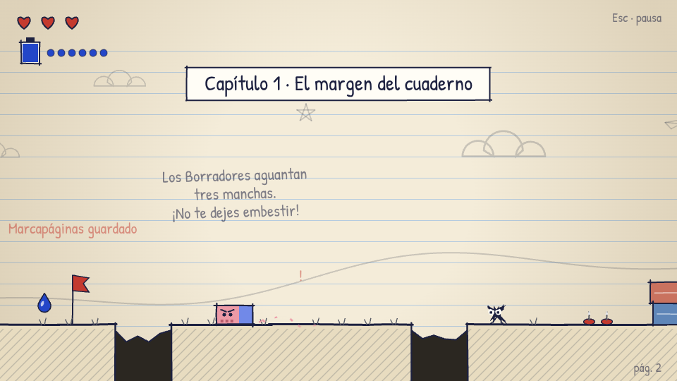
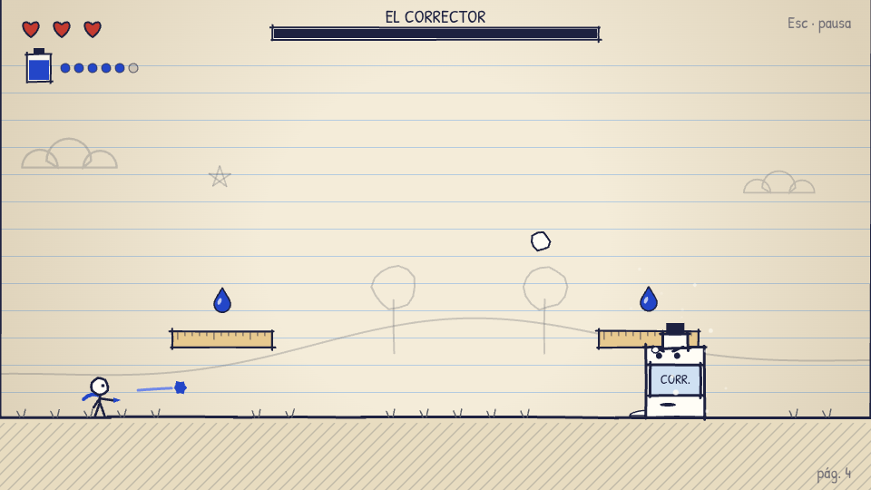
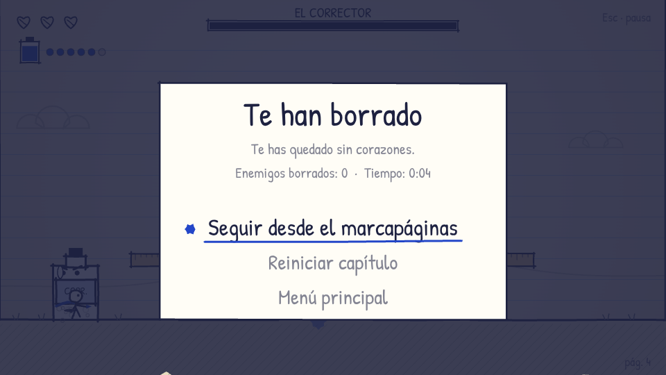
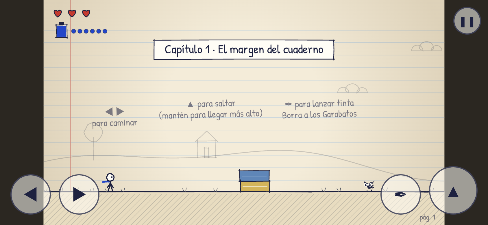

# 03 · Construcción y pruebas internas · demo 1.0

**Fechas:** 28 oct 2026 (construcción) · 30 oct 2026 (modo playtest) · **Commits:** `1ec8178` y siguientes.

## Qué se construyó

| Área | Contenido |
|---|---|
| Juego | Un capítulo completo: tutorial integrado, 5 tramos, dificultad creciente, jefe final, victoria |
| Mecánica | Lanzar manchas de tinta con tintero de 6 gotas que se recarga; pisar enemigos para aturdirlos |
| Enemigos | Garabato, Garabato volador, Borrador (3 golpes, embiste), chinchetas, El Corrector (3 ataques y fase de enfado) |
| Partida | 3 corazones, 4 marcapáginas, derrota, seguir o reiniciar, victoria con estadísticas |
| Interfaz | Título, «Cómo se juega», pausa, opciones de sonido, transiciones de pasar página |
| Plataformas | Teclado, ratón y táctil; aviso para girar el móvil en vertical; escala a cualquier pantalla |
| Audio | Música y efectos sintetizados en tiempo real |
| Medición | Modo `?playtest` que registra eventos de la partida |

| | |
|---|---|
|  |  |
|  |  |

## Cómo se probó

Todas las pruebas son **automáticas**, en Chromium sin interfaz. Se repitieron abriendo el archivo directamente y sirviéndolo por HTTP.

| Prueba | Resultado |
|---|---|
| 31 comprobaciones de recorrido con teclado y ratón reales (menús, mover, saltar, disparar, recarga, pausa, pausa automática, caída, derrota, seguir, reiniciar, marcapáginas, arena, jefe, victoria, jugar otra vez) | 31/31 ✅ |
| 10 comprobaciones táctiles en un móvil horizontal simulado (844×390) | 10/10 ✅ |
| Bot que juega el nivel entero (con invulnerabilidad) | Llega a la victoria ✅ |
| Bot sin invulnerabilidad | Pierde 3/3 ❌ (ver D-07) |
| Bucle real a 60 Hz con `requestAnimationFrame` | Sin errores ✅ |
| Modo playtest: registra eventos y el código se decodifica | ✅ |
| Consola sin errores ni avisos en todos los recorridos | ✅ |

## Errores encontrados y corregidos durante las pruebas

1. **El jefe se quedaba congelado en el aire.** Al saltar sobre una plataforma no detectaba el aterrizaje y no volvía a atacar. Se corrigió la detección y ahora el jefe ignora las plataformas.
2. **El ratón «robaba» la selección del menú.** Si el puntero quedaba sobre una opción, Enter activaba esa en lugar de la elegida con el teclado. Ahora el ratón solo cuenta cuando se mueve.
3. **Los menús ignoraban pulsaciones rápidas.** La pausa contra pulsaciones accidentales era demasiado larga (0,25 s); se redujo a 0,12 s.
4. **El tutorial pedía teclas en móvil.** Ahora los carteles cambian a los símbolos de los botones táctiles.
5. **El panel del código de playtest tapaba parte del menú de victoria.** Se movió a la esquina superior derecha.

## Lo que NO está probado

- **Ninguna persona real ha jugado todavía.** La dificultad, la claridad y la diversión no están medidas.
- No se ha probado en Safari, Firefox ni en móviles físicos.
- La versión web pública no está verificada: GitHub Pages está pendiente de activar.
- Sin pruebas de accesibilidad más allá del teclado: falta revisar contraste para daltonismo y legibilidad en pantallas pequeñas.
