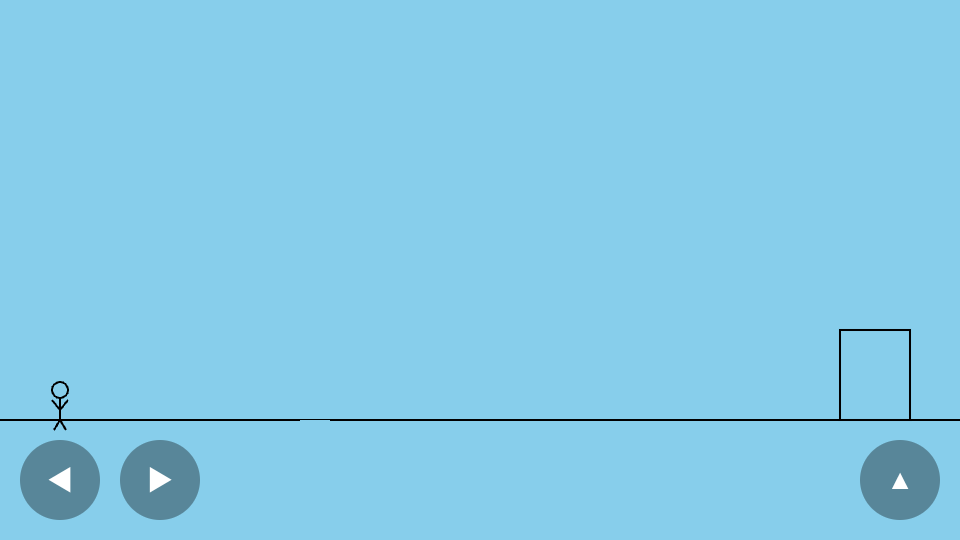
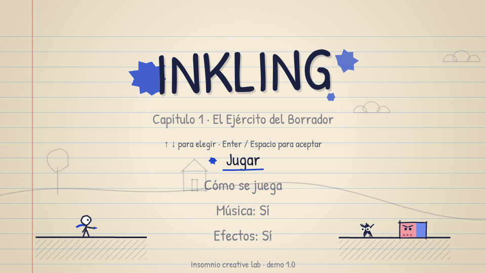

# INKLING · Dossier del proyecto

> Proyecto de **Insomnio creative lab**. Este dossier registra cómo evoluciona INKLING: qué se decidió y por qué, qué se probó, con quién, qué salió y qué cambió por ello.
> La regla es simple: **nada se da por bueno sin evidencia**. Si algo no se ha probado, se dice.

## Ficha

| | |
|---|---|
| **Qué es** | Plataformas 2D que vive en las páginas de un cuaderno. Un personaje de tinta borra al Ejército del Borrador lanzando manchas. |
| **Para quién** | Jugadores casuales de navegador y móvil; escaparate de Insomnio como estudio creativo-técnico. |
| **Pregunta central** | ¿Una mecánica pequeña (tinta como munición limitada) y una estética muy reconocible bastan para que alguien ajeno quiera jugar un capítulo 2? |
| **Versión actual** | demo 1.0 (28 oct 2026) |
| **Estado** | Construida y probada con pruebas automáticas. **Pendiente: test con personas reales.** |
| **Repositorio** | `gaabbboooo/stickman` |
| **Demo pública** | `https://gaabbboooo.github.io/stickman/` (pendiente de activar GitHub Pages y verificar) |
| **Modo playtest** | la misma URL terminada en `?playtest` |

## Ciclo de vida

Cada versión pasa por las mismas fases. El documento de cada fase es la evidencia de que ocurrió.

| Fase | Documento | Estado |
|---|---|---|
| 0 · Auditoría del punto de partida | [01-auditoria-v0.md](01-auditoria-v0.md) | ✅ hecho |
| 1 · Decisiones con sus motivos | [02-decisiones.md](02-decisiones.md) | 🔄 se actualiza siempre |
| 2 · Construcción y pruebas internas (1.0) | [03-construccion-v1.md](03-construccion-v1.md) | ✅ hecho |
| 3 · Plan de test con personas reales | [04-plan-playtest.md](04-plan-playtest.md) | ✅ listo para ejecutar |
| 4 · Resultados del test | [05-resultados-playtest.md](05-resultados-playtest.md) | ⏳ esperando sesiones |
| 5 · Hoja de ruta 2.0 | [06-hoja-de-ruta-v2.md](06-hoja-de-ruta-v2.md) | 📝 hipótesis, sin decidir |
| 6 · Lanzamiento 2.0 | (se creará) | — |

Cambios por versión: [CHANGELOG](../CHANGELOG.md). Capturas: [evidencia/](evidencia/).

## Antes y después

| v0 · prototipo heredado | v1.0 · demo |
|---|---|
|  |  |
